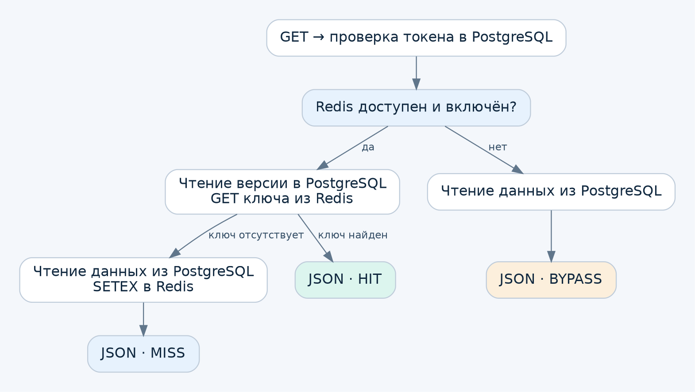
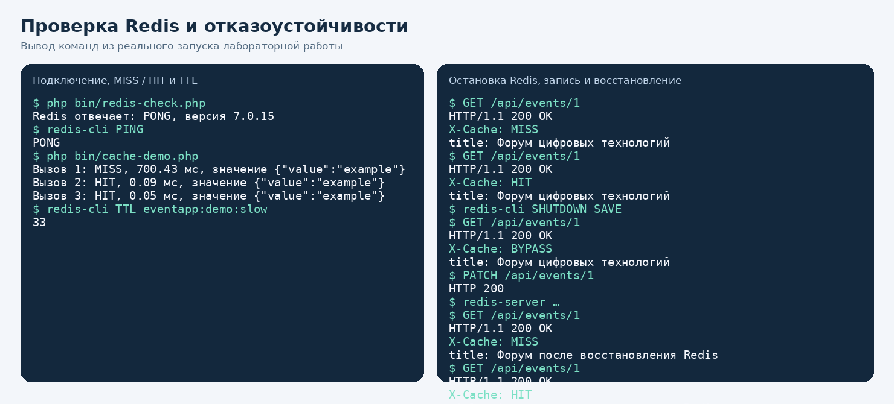
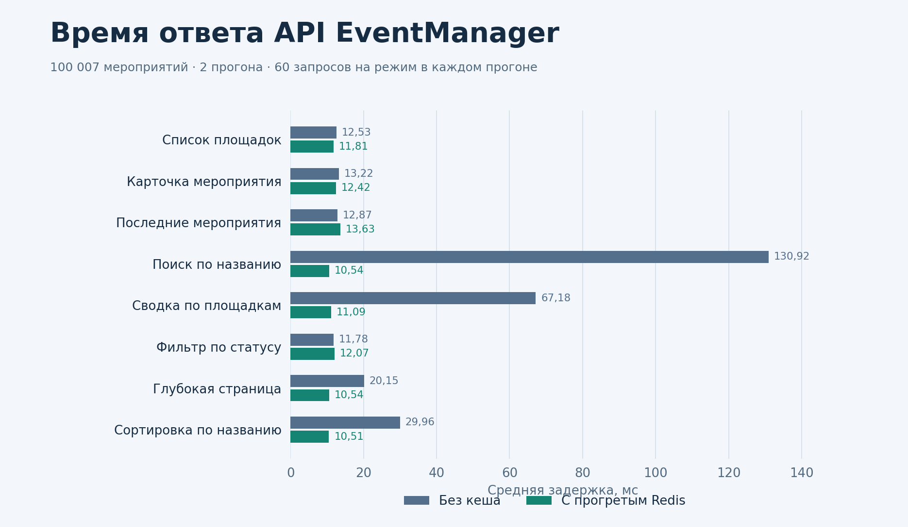

# Лабораторная работа № 10. Кеширование данных

**Предметная область** — EventManager, система управления мероприятиями.

## Цель

Интегрировать Redis с PHP REST API и PostgreSQL, реализовать cache-aside и инвалидацию, затем измерить влияние кеширования на задержку и пропускную способность чтения.

## Запуск из чистого клона

Требуются Docker Compose и PHP 8.2+ с расширениями `pdo_pgsql`, `redis` (phpredis), `curl` и `mbstring`. В `lab10/src`:

```powershell
docker compose up -d --wait
php bin/reset-db.php
php bin/redis-check.php
$env:APP_DEBUG = '1'
php -S localhost:8000 -t public public/router.php
```

В Linux и macOS для запуска с дополнительными процессами используется:

```bash
APP_DEBUG=1 PHP_CLI_SERVER_WORKERS=4 php -S localhost:8000 -t public public/router.php
```

Клиент доступен по адресу `http://localhost:8000/client/`. Учебный вход — `anna@example.com` / `123456`. Встроенный сервер PHP в Windows работает одним процессом. Параметры соединений можно переопределить через `DB_HOST`, `DB_PORT`, `REDIS_HOST`, `REDIS_PORT`. При использовании нестандартных портов одинаковые значения задаются для Compose, сервера и скриптов. `reset-db.php` пересоздаёт учебные таблицы и загружает тестовые данные.

### Проверка и измерение

Во втором терминале, в `lab10/src`:

```powershell
php tests/api-tests.php
php bin/cache-demo.php
php bin/load-bigdata.php
php bin/benchmark.php http://localhost:8000 60
php bin/benchmark.php http://localhost:8000 60
php bin/reset-db.php
```

Интеграционные тесты и бенчмарк требуют `APP_DEBUG=1` **в окружении сервера**. Этот режим разрешает заголовок `X-Cache-Mode: off`. Перед повторным тестированием следует восстановить учебный набор. Выгрузка измерений в JSON доступна с аргументом `--json` после числа запросов.

## Механизм, ключи и TTL



Чтение через `Cache::remember` сначала проверяет Redis. При попадании API сразу возвращает сохранённый JSON с `X-Cache: HIT`. При промахе читает PostgreSQL, сохраняет результат с TTL и возвращает `MISS`. При отказе Redis продолжает читать PostgreSQL и возвращает `BYPASS`.

| Данные | Ключ после префикса `eventapp:` | Базовый TTL |
|---|---|---:|
| Справочники | `venues:list:v<версия>:<md5>`, `categories:list:v<версия>:<md5>` | 300 с |
| Карточки | `<ресурс>:item:<id>:v<версия>` | 60 с |
| Списки мероприятий | `events:list:v<версия>:<md5>` | 60 с |
| Сводка по площадкам | `report:summary:v<версия>` | 120 с |

Фильтры, поиск, сортировка и пагинация участвуют в ключе списков. Подход со случайным разбросом TTL на 0–15 % уменьшает одновременное истечение ключей. PostgreSQL обновляет версию затронутого набора в транзакции записи. Изменения мероприятий и площадок также обновляют версию отчёта. Старые записи освобождаются по TTL. [Правила кеширования и инвалидации](docs/caching.md)

## Проверка Redis

```text
$ docker compose exec redis redis-cli PING
PONG
$ php bin/cache-demo.php
Вызов 1: MISS
Вызов 2: HIT
Вызов 3: HIT
$ docker compose exec redis redis-cli TTL eventapp:demo:slow
```

[Команды для защиты](docs/demo.md) · [Полный вывод Redis](docs/evidence/redis-check.txt) · [Тест отключения Redis](docs/evidence/outage.txt) · [Автотесты API](docs/evidence/tests.txt)



Проверки API — **67 пройдено, 0 ошибок**. При полной остановке Redis API вернул HTTP 200 и `BYPASS`. После изменения данных во время простоя и запуска Redis получены `MISS` с новым значением и затем `HIT`.

## Результаты измерений

Условия — PostgreSQL 16.16, Redis 7.0.15, PHP 8.4.24, 100 007 мероприятий. Выполнено два прогона по 60 запросов без кеша и 60 запросов с прогретым кешем на каждый из восьми сценариев.

| Сценарий | Без кеша, мс | С кешем, мс | Ускорение |
|---|---:|---:|---:|
| Список площадок | 12,53 | 11,81 | 1,06× |
| Карточка мероприятия | 13,22 | 12,42 | 1,06× |
| Последние мероприятия | 12,87 | 13,63 | 0,94× |
| Поиск по названию | 130,92 | 10,54 | 12,42× |
| Сводка по площадкам | 67,18 | 11,09 | 6,06× |
| Фильтр по статусу | 11,78 | 12,07 | 0,98× |
| Глубокая страница | 20,15 | 10,54 | 1,91× |
| Сортировка по названию | 29,96 | 10,51 | 2,85× |



[Среднее, p95, RPS, два полных прогона и анализ](docs/benchmark.md)

## Вывод

Кеширование дало наибольший эффект для поиска по названию и агрегатного отчёта. Для дешёвых выборок дополнительные операции с Redis сопоставимы со стоимостью исходного запроса. Версионная инвалидация обеспечивает получение свежих данных после записи, включая изменения во время отказа Redis.

[Контрольные вопросы](docs/questions.md) · [Требования к эксплуатации](docs/caching.md#для-эксплуатации)
