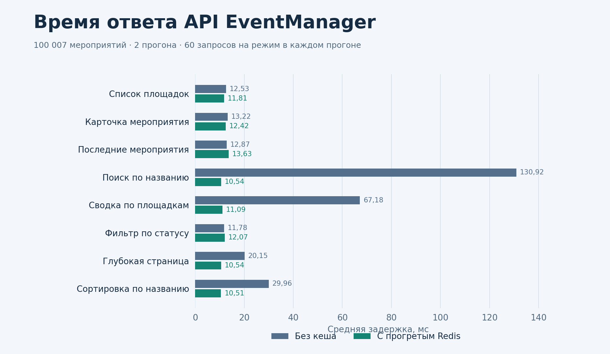

# Сравнение производительности

## Условия

- 100 007 мероприятий: 7 исходных и 100 000 строк из `sql/bigdata.sql`. После загрузки выполнен `ANALYZE events`.
- Linux x86-64, Intel Xeon Platinum 8370C @ 2,80 ГГц, 9 доступных логических процессоров и 9,7 ГиБ оперативной памяти.
- PHP 8.4.24, phpredis 6.2.0, PostgreSQL 16.16, Redis 7.0.15. PHP, PostgreSQL и Redis работали на одной машине, HTTP-запросы шли по loopback.
- PHP запущен с `PHP_CLI_SERVER_WORKERS=4`. Клиент отправлял запросы последовательно. Приведённый RPS равен числу запросов, делённому на суммарное время ответов.
- Для каждого сценария и прогона: два разогревающих BYPASS, 60 измеряемых BYPASS, отдельный холодный MISS и 60 измеряемых HIT. Бенчмарк проверял HTTP 200 и ожидаемое значение `X-Cache` каждого запроса. Запросы к API включают проверку токена.
- p95 — элемент с порядковым номером `ceil(0.95 × N)` в упорядоченной выборке. Холодный запрос вынесен в отдельный столбец и не включён в статистику HIT.

## Результаты

Во всех парных столбцах первым указано значение **без кеша**, вторым — **с прогретым кешем**. Коэффициент больше 1 означает ускорение.

### Прогон 1

| Сценарий | Среднее, мс | p95, мс | RPS | MISS, мс | Ускорение |
|---|---:|---:|---:|---:|---:|
| Список площадок | 14,51 / 13,52 | 26,01 / 23,79 | 68,9 / 73,9 | 9,26 | 1,07× |
| Карточка мероприятия | 15,24 / 14,43 | 30,47 / 25,93 | 65,6 / 69,3 | 9,97 | 1,06× |
| Последние мероприятия | 15,08 / 13,91 | 26,37 / 23,60 | 66,3 / 71,9 | 10,31 | 1,08× |
| Поиск по названию | 141,27 / 11,05 | 256,57 / 18,49 | 7,1 / 90,5 | 156,40 | 12,78× |
| Сводка по площадкам | 70,63 / 11,93 | 111,08 / 22,90 | 14,2 / 83,8 | 62,78 | 5,92× |
| Фильтр по статусу | 11,41 / 12,14 | 19,55 / 20,33 | 87,7 / 82,4 | 21,83 | 0,94× |
| Глубокая страница | 21,51 / 11,06 | 33,74 / 18,31 | 46,5 / 90,4 | 26,61 | 1,94× |
| Сортировка по названию | 30,75 / 10,97 | 46,52 / 17,38 | 32,5 / 91,2 | 20,75 | 2,80× |

### Прогон 2

| Сценарий | Среднее, мс | p95, мс | RPS | MISS, мс | Ускорение |
|---|---:|---:|---:|---:|---:|
| Список площадок | 10,55 / 10,09 | 15,47 / 16,40 | 94,8 / 99,1 | 13,66 | 1,05× |
| Карточка мероприятия | 11,19 / 10,40 | 17,38 / 17,22 | 89,3 / 96,1 | 44,93 | 1,08× |
| Последние мероприятия | 10,67 / 13,35 | 16,43 / 23,56 | 93,7 / 74,9 | 12,95 | 0,80× |
| Поиск по названию | 120,56 / 10,04 | 175,79 / 14,09 | 8,3 / 99,6 | 135,89 | 12,01× |
| Сводка по площадкам | 63,73 / 10,26 | 88,68 / 17,18 | 15,7 / 97,5 | 49,62 | 6,21× |
| Фильтр по статусу | 12,16 / 12,00 | 19,15 / 18,72 | 82,2 / 83,3 | 7,23 | 1,01× |
| Глубокая страница | 18,78 / 10,02 | 29,17 / 15,87 | 53,3 / 99,8 | 20,20 | 1,87× |
| Сортировка по названию | 29,17 / 10,05 | 43,60 / 16,61 | 34,3 / 99,5 | 31,13 | 2,90× |

Исходные результаты: [прогон 1](evidence/run1.json), [прогон 2](evidence/run2.json). Диаграмма сравнивает средние задержки, объединённые по двум равным выборкам.

## Анализ

Наибольший выигрыш дал сценарий «Поиск по названию» — 12,42×. Поиск подстроки через `ILIKE` вместе с сортировкой по названию обрабатывает значительную часть таблицы. Кеш сокращает этот путь до чтения версии и готового результата. Сводка по площадкам ускорилась в 6,06× за счёт исключения соединения и агрегации.

Наименьший результат у сценария «Последние мероприятия» — 0,94×. Дешёвые выборки, включая чтение по первичному ключу и списки с малым количеством строк, сопоставимы по цене с подключением к Redis, чтением версии и декодированием JSON. Для быстрых сценариев небольшие отличия между прогонами чувствительны к колебаниям планирования процессов. Направление и масштаб выигрыша совпали с прогнозом для дорогого поиска и отчёта.

Первое чтение нового ключа обращается к PostgreSQL и заполняет Redis. Повторное чтение выполняется из кеша до истечения TTL или изменения версии. При ежесекундных записях доля HIT зависит от числа однотипных запросов между обновлениями. Если те же ключи редко читают повторно, инвалидация сокращает выигрыш и добавляет стоимость заполнения. Кеш можно исключить для дешёвых индексных выборок, уникальных запросов и наборов с частыми изменениями.
