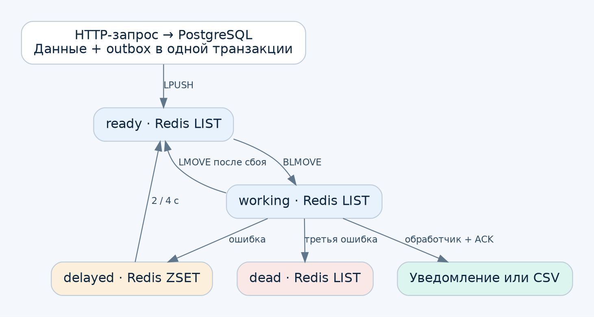
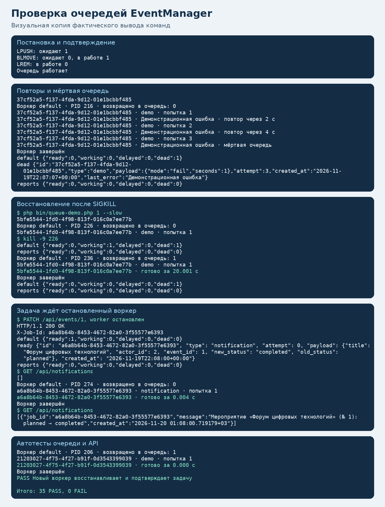
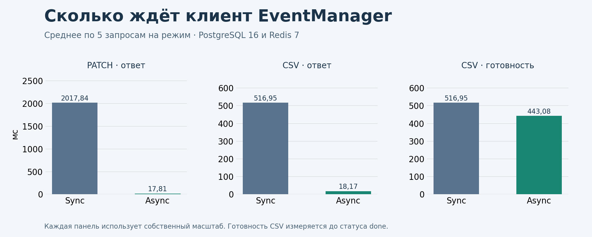

# Лабораторная работа № 11. Асинхронная обработка данных

**Приложение** — EventManager. Основа проекта — REST API, клиент, авторизация, база и кеш из лабораторной работы № 10.

## Цель

Реализовать очередь сообщений Redis и отдельные воркеры. Вынести уведомления о смене статуса мероприятия и экспорт CSV из HTTP-запроса. Проверить восстановление задач после сбоев и измерить задержку ответа в синхронном и асинхронном режимах.

## Запуск

Требуются Git, Docker Compose и PHP 8.2+ с расширениями `pdo_pgsql`, `redis`, `curl` и `mbstring`. Для обработки сигналов на Linux и macOS требуется `pcntl`.

Из каталога `lab11/src` в PowerShell:

```powershell
docker compose up -d --wait
php bin/reset-db.php
php bin/queue-check.php
$env:APP_DEBUG = '1'
php -S 127.0.0.1:8000 -t public public/router.php
```

В двух других терминалах, из того же каталога:

```powershell
php bin/worker.php
php bin/worker.php --queue=reports
```

Команды воркеров запускаются в разных терминалах. Клиент — [http://127.0.0.1:8000/client/](http://127.0.0.1:8000/client/). Демонстрационные учётные записи — `anna@example.com` (руководитель), `igor@example.com` (редактор), `maria@example.com` (наблюдатель). Пароль для них — `123456`.

Порты PostgreSQL и Redis по умолчанию — **5433** и **6380**, имя БД — `eventapp11`. Если эти порты заняты, переменные `DB_PORT` и `REDIS_PORT` задаются одинаково для Compose, PHP-сервера, воркеров и скриптов. Папка `storage/reports` должна быть доступна для записи воркеру и чтения HTTP-серверу. Перед сбросом учебной базы остановить оба воркера и завершить активные запросы.

### Тесты

При запущенном HTTP-сервере с `APP_DEBUG=1` и остановленных внешних воркерах:

```powershell
php bin/reset-db.php
php tests/api-tests.php
php bin/reset-db.php
php tests/cache-tests.php
```

Основной тест запускает свои процессы воркеров. Тесты рассчитаны на небольшой исходный набор; после бенчмарка требуется восстановить его. Учебный режим `APP_DEBUG` разрешает заголовок `X-Queue-Mode: sync` и обход кеша для регрессионных тестов.

## Очередь и обработка



Каждая очередь имеет ключи `eventapp11:queue:<имя>:ready`, `:working`, `:delayed` и `:dead`. Задача — JSON с UUID, типом, полезной нагрузкой, числом попыток и временем постановки. Документация формата приведена в [описании очереди](docs/queue.md).

API фиксирует outbox вместе с изменением данных, затем публикует задачу в Redis через `LPUSH`. Если Redis недоступен, воркер пересылает сохранённую запись после восстановления. `BLMOVE` атомарно переносит задачу в рабочий список. После выполнения `LREM` подтверждает результат. При исключении запуск повторяется через 2 и 4 секунды, после третьей ошибки задача переходит в `dead`. При новом запуске воркер возвращает неподтверждённые задачи через `LMOVE`. На Linux и macOS при SIGTERM/SIGINT воркер завершает текущую задачу. Windows без `pcntl` поддерживает восстановление при следующем запуске.

| Операция | Ответ API | Получение результата |
|---|---|---|
| Смена статуса мероприятия | `PATCH /api/events/{id}` возвращает HTTP 200 и `X-Job-Id` при изменении статуса. | Руководитель читает `GET /api/notifications`. Автор исключается из получателей. |
| Заказ экспорта | `POST /api/reports` возвращает HTTP 202, `X-Job-Id` и `Location`. | `GET /api/reports/{id}` показывает состояние и ссылку на CSV после `done`. Автор заявки и руководители имеют доступ. |

Уведомления проходят через `default`, отчёты — через `reports`. Раздельные воркеры позволяют выполнять уведомления, пока формируется большой CSV. Неизменный статус не ставит уведомление в очередь. Повтор уведомления не создаёт лишнюю строку, а повтор завершённого отчёта не перезаписывает готовый файл.

## Проверки надёжности

- [LPUSH → BLMOVE → LREM](docs/evidence/check.txt) и [результаты автотестов](docs/evidence/tests.txt).
- [Постановка при остановленном воркере](docs/evidence/wait.txt) — HTTP-ответ получен сразу, задача обработана после запуска.
- [Постоянная ошибка](docs/evidence/dead.txt) — три попытки, две паузы и запись в мёртвой очереди.
- [Принудительное завершение](docs/evidence/recovery.txt) — задача осталась в `working` после SIGKILL, новый воркер восстановил и подтвердил её.
- [Корректное завершение](docs/evidence/signal.txt) — SIGTERM дождался окончания задачи.
- [Остановка Redis](docs/evidence/outbox.txt) — изменение статуса сохранилось, outbox опустела после доставки.



Подробные команды, примеры запросов и ответы для защиты приведены в [руководстве по демонстрации](docs/demo.md) и [контрольных вопросах](docs/questions.md).

## Результаты измерений

Пять запросов на режим, 100 007 мероприятий, PostgreSQL 16.16 и Redis 7.0.15. Для уведомления моделировалась двухсекундная задержка доставки. CSV построен на реальной выборке из PostgreSQL.

| Метрика | Sync, мс | Async, мс |
|---|---:|---:|
| PATCH, ответ | 2017,84 | 17,81 |
| POST CSV, ответ | 516,95 | 18,17 |
| CSV, готовность | 516,95 | 443,08 |



[Методика, исходные измерения и анализ](docs/benchmark.md)

## Вывод

Асинхронный заказ отчёта подтвердился в среднем за 18,17 мс. Файл стал доступен в среднем через 443,08 мс. Для смены статуса время ответа сократилось с 2017,84 до 17,81 мс. Повторная доставка безопасна для обоих обработчиков. Восстановление проверено с принудительным завершением воркера и остановкой Redis.

Автоматические проверки — **35 тестов очереди и 67 регрессионных тестов API и кеша**, все прошли.
