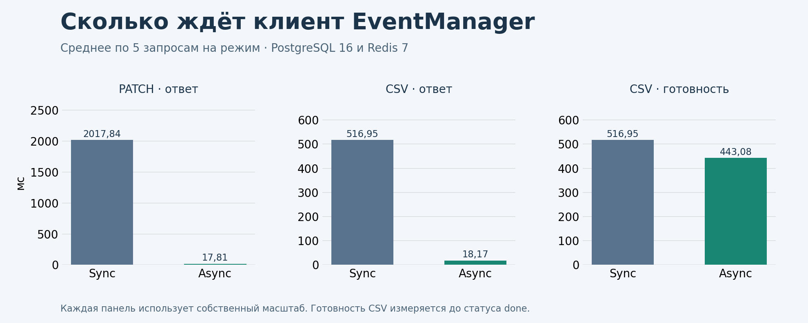

# Измерения задержки

## Методика

- Linux x86-64, PHP 8.4.24, phpredis 6.2.0, PostgreSQL 16.16 и Redis 7.0.15. PHP HTTP-сервер запущен с `PHP_CLI_SERVER_WORKERS=4`, оба воркера работали отдельно.
- PostgreSQL содержал 100 007 мероприятий. Выгружались все строки. Клиент, воркеры, Redis и база находились на одной машине. HTTP-запросы отправлялись на loopback.
- Пять итераций. В каждой итерации сначала выполнялись операции sync, затем async. Для синхронного режима передавался учебный заголовок `X-Queue-Mode: sync`. Все запросы использовали один токен редактора.
- `NOTIFICATION_DELAY=2` у сервера и основного воркера имитировала медленную доставку уведомления. CSV строился из реальных данных, без искусственной задержки.
- `PATCH` менял статус на другой при каждом запросе. Для заказа отчёта измерялись задержка HTTP и метка `done`, обнаруженная через опрос с паузой 25 мс. В sync успешный HTTP-ответ приходит после завершения CSV.
- Время измерялось в клиенте с помощью монотонных часов `hrtime`. Для повторения, после загрузки данных и запуска процессов, выполняется `php bin/bench-async.php --n=5`. В PowerShell переменная задаётся как `$env:NOTIFICATION_DELAY = '2'` перед запуском сервера и основного воркера.

## Результаты

| Метрика | Sync, мс | Async, мс |
|---|---:|---:|
| PATCH, ответ | 2017,84 | 17,81 |
| POST CSV, ответ | 516,95 | 18,17 |
| CSV, готовность | 516,95 | 443,08 |

[Пять измерений на режим](evidence/bench.json) · [Журнал воркера уведомлений](evidence/notify-bench.txt) · [Журнал воркера CSV](evidence/report-bench.txt)

С постановкой в очередь PATCH ответил в 113,28 раза быстрее, а HTTP-подтверждение заказа CSV — в 28,45 раза быстрее. Затраты на выборку и формирование файла остались. Разница между HTTP-подтверждением и готовностью CSV в async составила в среднем 424,91 мс. Она включает ожидание воркера, обработку и интервал опроса.

Асинхронный ответ позволяет интерфейсу продолжить работу и показать состояние заявки. При высокой нагрузке растёт очередь и срок готовности. Воркеры нужно запускать и контролировать отдельно, а ошибки обработки показывать через статус, журнал и мёртвую очередь.
