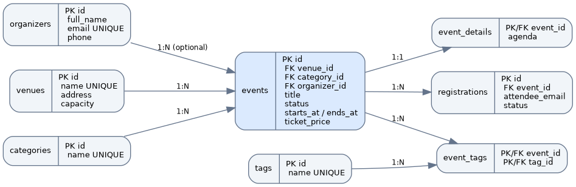

# Лабораторная работа №8. Проектирование и реализация базы данных

**Модуль:** Разработка web-приложений  
**Тема:** Работа с данными в информационных системах  
**Предметная область:** система управления мероприятиями EventManager

## Цель работы

Спроектировать реляционную базу данных PostgreSQL, реализовать таблицы и связи между ними, обеспечить целостность данных, выполнить CRUD-операции и исследовать оптимизацию SQL-запросов.

## Структура проекта

- `docker-compose.yml` — PostgreSQL 16, база `eventmanager`.
- `sql/01_schema.sql` — определение восьми таблиц и ограничений.
- `sql/02_seed.sql` — исходные данные.
- `sql/03_integrity.sql` — проверки PK, FK, UNIQUE, NOT NULL, CHECK, RESTRICT, SET NULL и CASCADE.
- `sql/04_crud.sql` — демонстрационные операции создания, чтения, изменения и удаления.
- `sql/05_test_data.sql` — генерация 150 000 дополнительных мероприятий.
- `sql/06_optimization.sql` — три сравнения EXPLAIN ANALYZE до и после индексации.
- `diagrams/src/er.puml` — исходный код ER-диаграммы.
- `diagrams/images/er.png` — изображение ER-диаграммы.
- `docs/optimization.md` — протокол измерения производительности.
- `docs/testing.md` — последовательность проверки.

## Предметная область и сущности

| Роль | Сущность | Таблица | Основные поля |
|---|---|---|---|
| Основная | Мероприятие | `events` | `id`, `venue_id`, `category_id`, `organizer_id`, `title`, `status`, `starts_at`, `ends_at`, `ticket_price` |
| Связанная | Площадка | `venues` | `id`, `name`, `address`, `capacity` |
| Третья | Категория | `categories` | `id`, `name`, `description` |
| Дополнительная | Организатор | `organizers` | `id`, `full_name`, `email`, `phone` |
| Дополнительная | Детали мероприятия | `event_details` | `event_id`, `agenda`, `contact_email`, `online_url` |
| Дополнительная | Регистрация | `registrations` | `id`, `event_id`, `attendee_name`, `attendee_email`, `status` |
| Дополнительная | Тег | `tags` | `id`, `name` |
| Связующая | Теги мероприятий | `event_tags` | `event_id`, `tag_id` |

### Связи и ограничения

- `venues → events` и `categories → events`: 1:N, `ON DELETE RESTRICT`. Удаление площадки или категории с мероприятиями запрещено.
- `organizers → events`: 1:N, `ON DELETE SET NULL`. При удалении организатора мероприятие сохраняется.
- `events → event_details`: 1:1, `event_id` одновременно PK и FK, `ON DELETE CASCADE`.
- `events → registrations`: 1:N, `ON DELETE CASCADE`.
- `events ↔ tags`: N:M через `event_tags` с составным PK `(event_id, tag_id)` и `ON DELETE CASCADE`.
- `NOT NULL` — обязательные поля; `UNIQUE` — уникальные названия и email; `CHECK` — статусы, длина названия, вместимость, неотрицательная стоимость и корректный интервал времени; `DEFAULT` — начальный статус и временные метки.

## ER-диаграмма



Исходник PlantUML: `diagrams/src/er.puml`.

## Запуск PostgreSQL

```bash
cd lab8
docker compose up -d
docker compose exec db psql -U postgres -d eventmanager
```

Параметры подключения: `localhost:5432`, база `eventmanager`, пользователь `postgres`, пароль `secret`. Для изменения порта используется `DB_PORT=5433 docker compose up -d`.

Скрипты выполняются в указанном порядке:

```sql
\i /sql/01_schema.sql
\i /sql/02_seed.sql
\i /sql/03_integrity.sql
\i /sql/04_crud.sql
\i /sql/05_test_data.sql
\i /sql/06_optimization.sql
```

После заполнения исходными данными должно быть 7 мероприятий; после генерации нагрузочных данных — 150 007. Для повторного выполнения `02_seed.sql` необходимо пересоздать таблицы через `01_schema.sql`. Скрипт `04_crud.sql` откатывает демонстрационные изменения.

## Примеры SQL-запросов

```sql
-- Получение списка мероприятий со статусом planned.
SELECT id, title, starts_at FROM events WHERE status = 'planned' ORDER BY starts_at;

-- Мероприятия и названия площадок.
SELECT e.title, v.name AS venue FROM events e JOIN venues v ON v.id = e.venue_id;

-- Изменение статуса одной записи.
UPDATE events SET status = 'active' WHERE id = 3;

-- Количество мероприятий по категориям.
SELECT c.name, COUNT(e.id) AS total FROM categories c
LEFT JOIN events e ON e.category_id = c.id GROUP BY c.id, c.name;
```

Полный набор INSERT, SELECT, UPDATE и DELETE приведён в `sql/04_crud.sql`.

## Анализ и оптимизация

Скрипт `06_optimization.sql` анализирует запросы по площадке, категории и статусу в заданном временном интервале. Для каждого запроса сначала выполняется `EXPLAIN (ANALYZE, BUFFERS)` без дополнительного индекса, затем создаётся составной B-tree индекс и повторяется измерение. Используются индексы `idx_events_venue_start`, `idx_events_category_start` и `idx_events_status_start`.

| Запрос | Индекс | Время до, мс | Время после, мс | Ускорение |
|---|---|---:|---:|---:|
| Площадка и период | `(venue_id, starts_at)` | — | — | — |
| Категория и период | `(category_id, starts_at)` | — | — | — |
| Статус и период | `(status, starts_at)` | — | — | — |

**Примечание:** численные результаты и планы не указаны до фактического выполнения PostgreSQL. Они фиксируются по выводу `EXPLAIN ANALYZE` в `docs/optimization.md` и `docs/explain-results.txt`. Наличие индекса не гарантирует выбор `Index Scan` планировщиком.

## Вывод

Спроектирована схема PostgreSQL для системы управления мероприятиями из восьми взаимосвязанных таблиц. Реализованы первичные и внешние ключи, ограничения целостности, связи 1:N, 1:1 и N:M, набор CRUD-запросов и сценарии проверки. Подготовлены SQL-запросы для исследования планов выполнения и сравнения производительности до и после создания индексов. Фактические результаты измерений фиксируются после запуска базы данных.
